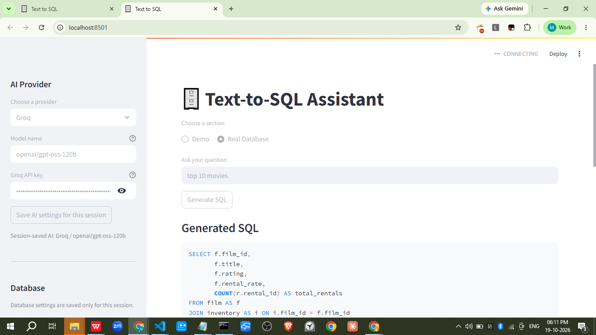

# Text-to-SQL Assistant

Ask questions in plain English and use an LLM to generate SQL for a database. The Streamlit app can run against the bundled SQLite demo database or a MySQL database you configure. It displays the generated SQL, query results, and a natural-language explanation.



## Features

- Demo mode uses the bundled `uber.db` SQLite database.
- Real Database mode connects to a MySQL database using credentials you provide.
- Supports OpenAI, Google Gemini, and Groq models through the sidebar.
- Inspects database tables, columns, primary keys, and foreign keys to provide schema context to the LLM.
- Saves selected AI and database settings to the current Streamlit session when you press the corresponding Save button.
- Saves inspected schema metadata as `schema_<database-name>.json` in the project root.
- Shows generated SQL and query results, then asks the selected model to explain the results.

## Requirements

- Python 3.12 or newer
- An API key for at least one supported AI provider
- MySQL Server and credentials if you want to use Real Database mode
- SQLite is included with Python; the Demo mode uses the included `uber.db`

## Project setup

### 1. Get the project

Clone the repository and open a terminal in the project folder:

```powershell
git clone https://github.com/shahil04/Text-to-SQL-Chatbot.git
cd Text-to-SQL-Chatbot
```

If you already have the project, open a terminal in its root directory instead.

### 2. Create and activate a virtual environment

On Windows PowerShell:

```powershell
py -3.12 -m venv .venv
.\.venv\Scripts\Activate.ps1
```

If PowerShell blocks activation, run this for the current terminal and activate again:

```powershell
Set-ExecutionPolicy -Scope Process -ExecutionPolicy Bypass
.\.venv\Scripts\Activate.ps1
```

On macOS or Linux:

```bash
python3.12 -m venv .venv
source .venv/bin/activate
```

### 3. Install dependencies

With the virtual environment activated:

```bash
python -m pip install --upgrade pip
python -m pip install -r requirements.txt
```

Alternatively, if you use `uv`:

```bash
uv sync
```

## Configure credentials

Create a `.env` file in the project root. You can copy `.env.example` and replace the example values:

```powershell
Copy-Item .env.example .env
```

Use the following format in `.env` (do not include spaces around `=`):

```env
OPENAI_API_KEY=your-openai-api-key
GEMINI_API_KEY=your-gemini-api-key
GOOGLE_API_KEY=your-gemini-api-key
GROQ_API_KEY=your-groq-api-key

DB_HOST=localhost
DB_PORT=3306
DB_USER=your-mysql-user
DB_PASSWORD=your-mysql-password
DB_NAME=your-mysql-database
```

Only the API key for your selected provider is required. `GOOGLE_API_KEY` is included as an alias for Gemini integrations that expect that environment variable.

The MySQL values are used to prefill the Real Database fields. You can also enter the credentials directly in the app. Press **Save database settings for this session** to test the connection, inspect the schema, and keep those credentials in the current Streamlit session. AI provider settings also require pressing **Save AI settings for this session** before generating SQL.

Credentials saved in the app are held in Streamlit session state; they are not written to the schema file. The generated schema file contains database metadata, not passwords or API keys.

> Never commit `.env` or share API keys or database passwords. Use a least-privilege, read-only MySQL user where possible. The SQL checks in the demo are basic safeguards, not a substitute for database permissions.

## Run the application

From the project root, with the virtual environment activated:

```bash
streamlit run main.py
```

Streamlit prints a local URL, usually `http://localhost:8501`, and may open it in your browser.

### Use Demo mode

1. Select **Demo** at the top of the app.
2. In the sidebar, save the AI provider and model settings.
3. Press **Save demo database for this session**.
4. Enter a question, such as `Show the top 10 trips`, and select **Generate SQL**.

Demo mode uses the `uber.db` file in the project root. To recreate it if it is missing:

```bash
python sql_lite_datacreate.py
```

### Use Real Database mode

1. Select **Real Database** at the top of the app.
2. Enter the MySQL host, port, username, password, and database name in the sidebar. Values from `.env` are used as initial values.
3. Press **Save database settings for this session**. The app tests the connection and writes the inspected schema to `schema_<database-name>.json`.
4. Save the AI provider settings if you have not already.
5. Enter a question and select **Generate SQL**.

The database settings and provider API key remain available only for the current Streamlit session. If you change the selected database mode, save the corresponding database settings for that mode before generating SQL.

## Other apps

The repository also includes:

- `demo.py` — Streamlit MySQL demo.
- `demo_sqllite.py` — Streamlit SQLite demo. Its Real Database section is an informational placeholder and does not connect to MySQL.

Run them from the project root:

```bash
streamlit run demo.py
streamlit run demo_sqllite.py
```

## Project structure

```text
app/                         Reusable database, schema, retrieval, and SQL pipeline modules
knowledge/schema.json        Schema metadata used by the reusable pipeline
main.py                      Main Streamlit app (SQLite Demo and MySQL Real Database modes)
demo.py                      MySQL Streamlit demo
demo_sqllite.py              SQLite Streamlit demo
sql_interface.png            Application screenshot used above
sql_lite_datacreate.py       Creates the sample SQLite database
uber.db                      Bundled SQLite demo database
requirements.txt             Python dependencies
pyproject.toml               Project metadata and uv dependencies
```

## Troubleshooting

- **`uber.db` not found:** run `python sql_lite_datacreate.py` from the project root.
- **MySQL connection failed:** verify that MySQL is running and check the host, port, username, password, and database name. Make sure the selected user can connect to that database.
- **No schema file found:** in Real Database mode, save the database settings again to inspect the database and create its schema file.
- **AI authentication or model error:** check the selected provider, API key, and provider-supported model name, then save the AI settings again.
- **Missing Python package:** activate `.venv` and run `python -m pip install -r requirements.txt`.
